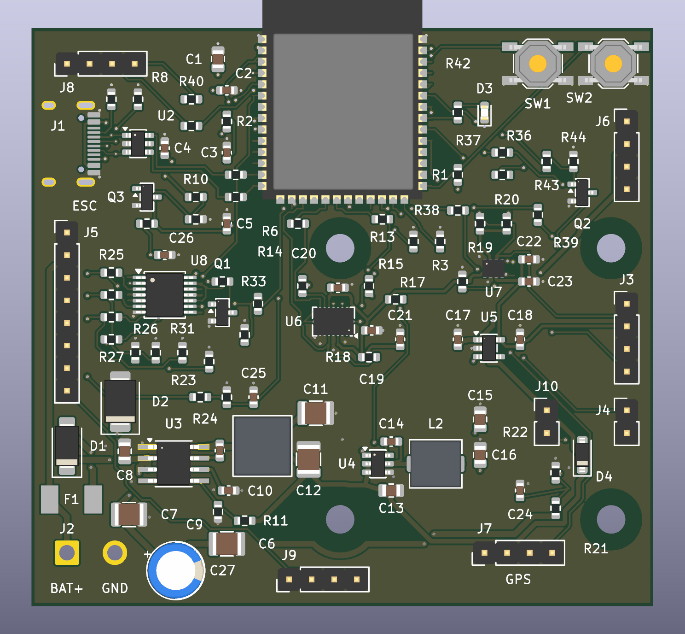

# ESP32_FC — ESP32-S3 quadcopter controller prototype

Rev B is a **70 × 65 mm, four-layer flight-controller hardware prototype** built around an ESP32-S3-WROOM-1-N8R8, a BMI088 SPI inertial sensor and a BMP280 barometer. It is intended for a quadcopter using a separate 4-in-1 ESC. The controller accepts a 3S–6S LiPo supply (9–25.2 V); motor current flows through the ESC.

**Status: unbuilt prototype. No flight firmware is included.** Design-file checks passed in KiCad 10.0.7 on 2026-10-15. No assembled board, power system, ESC interface, control loop or failsafe has been validated. These files support a small prototype order subject to manufacturer DFM acceptance; they do not establish flight or production readiness.

The preview omits some component bodies and is not a complete mechanical model.

## Download and open

1. [Download the complete repository ZIP](https://github.com/JS2028EE/ESP32_FC/archive/refs/heads/main.zip) and extract it.
2. Install KiCad 10 with its standard symbol, footprint and 3D-model libraries.
3. Open [ESP32_FC.kicad_pro](hardware/revB/ESP32_FC.kicad_pro) inside `hardware/revB`. Keep the whole folder together, including its five schematic sheets, local footprint library and `fp-lib-table`.
4. Open the schematic or PCB from KiCad's project manager. In PCB Editor, press **Alt+3** for the 3D Viewer. No standalone STEP assembly is supplied; some model bodies are missing.

For bare-board fabrication, use [ESP32_FC_RevB_Gerbers.zip](downloads/ESP32_FC_RevB_Gerbers.zip) and the [ordering instructions](hardware/revB/Order_Instructions.md). Do not upload the whole repository as a Gerber order. Rev A is superseded.

## Documentation

| Topic | Read |
|---|---|
| Purpose, architecture and intended performance | [System overview](docs/architecture.md) |
| What is missing and what remains untested | [Limitations](docs/limitations.md) |
| All connectors, GPIOs and ESC wiring | [Connections](docs/connections.md) |
| Component selection and buying parts | [Components](docs/components.md) |
| Power rails, load allocations and protection | [Power design](docs/power.md) |
| Firmware requirements and failsafes | [Firmware plan](docs/firmware.md) |
| Dimensions, mounting, layer stack and assembly | [Mechanical and manufacturing](docs/manufacturing.md) |
| Soldering and staged first power-up | [Assembly and bring-up](hardware/revB/Assembly_and_Bringup.md) |
| Checks performed and release boundary | [Validation](hardware/revB/Validation.md) |
| Datasheets and manufacturer references | [Sources](hardware/revB/Sources.md) |
| Revision history | [Change log](CHANGELOG.md) |
| File locations and reproducibility | [Repository guide](docs/repository-guide.md) |
| Contributions and reuse | [Contributing](CONTRIBUTING.md), [licensing status](THIRD_PARTY_NOTICES.md) |

## Main deliverables

- [Schematic PDF, five sheets](hardware/revB/Schematic.pdf) and [assembly drawing](hardware/revB/Assembly_Top.pdf).
- [Editable PCB](hardware/revB/ESP32_FC.kicad_pcb) and [root schematic](hardware/revB/ESP32_FC.kicad_sch).
- [Detailed BOM](hardware/revB/BOM.csv), [grouped shopping list](hardware/revB/Shopping_List.csv), [placement CSV](hardware/revB/Pick_and_place.csv) and [connector pad map](hardware/revB/Connector_Pin_Map.csv).
- [Raw fabrication outputs](hardware/revB/Fabrication), [DRC](hardware/revB/DRC.json), [ERC](hardware/revB/ERC.json), [audit summary](hardware/revB/Design_Audit.json) and [SHA-256 manifest](SHA256SUMS.json).

## Key integration constraints

J5 is a custom **2.54 mm** header and needs a function-matched harness. The reference Holybro Tekko32 F4 4in1 50A AM32 (SKU31102) supports **4S–6S**, so the reference combination starts at 4S. USB is full-speed **12 Mbps, data-only** and needs battery/bench power. Serial logic is 3.3 V. Motor outputs are unidirectional; bidirectional DShot is unsupported. No independent hardware watchdog removes motor enable after a software freeze.

High clock speed is not evidence of a deterministic flight-control loop. A 1 kHz loop is an initial firmware target that must be measured under worst-case load. No stock Betaflight, PX4 or ArduPilot binary is assumed to support this custom board.
