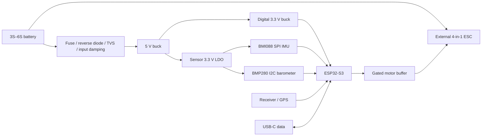

# Purpose and architecture

The purpose is to develop and bench-test an ESP32-S3-based quadcopter controller with local attitude sensing and four ESC control outputs. This revision prioritizes a roomy, hand-assembled prototype rather than minimum size or weight. It supplies avionics only; it does not switch motor power.

The module provides dual-core processing up to 240 MHz, 8 MB flash and 8 MB octal PSRAM. GPIO35/36/37 are reserved for the selected memory configuration. Internal SRAM should hold time-critical control code and sensor buffers. PSRAM, wireless activity and flash operations introduce timing constraints that need measurement.

The BMI088 has separate accelerometer and gyro chip-selects and data-ready lines on a shared SPI bus. Its maximum SPI clock is 10 MHz; gyro output reaches 2 kHz and accelerometer output reaches 1.6 kHz. Those device limits do not establish the achievable closed-loop rate. Begin firmware development around a measured 1 kHz gyro-triggered loop. The BMP280 provides slower pressure measurements; no magnetometer is fitted.

The PCB separates a continuous second-layer ground plane, a digital power layer and outer routing. The design includes battery/current measurement, receiver and GPS serial ports, debug UART, auxiliary I2C, status LED, active-buzzer switching, native USB and a physical output-disable strap. See the [pin assignments](../hardware/revB/README.md) and [sources](../hardware/revB/Sources.md).
